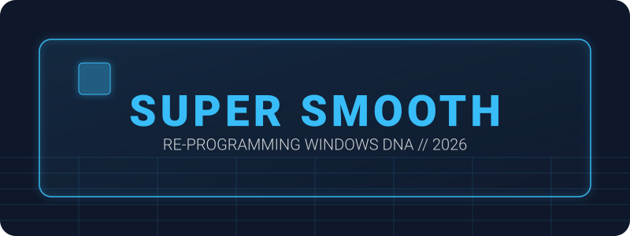

<div align="center">



<br>

<a href="https://git.io/typing-svg">
  
</a>

<br><br>

<table border="0" width="100%" style="border-collapse: collapse;">
  <tr>
    <td width="60%" valign="middle">
      <div style="background: #1e293b; border-left: 5px solid #38BDF8; padding: 25px; border-radius: 12px; box-shadow: 15px 15px 0px rgba(56,189,248,0.1);">
        <p>Out-of-the-box Windows is trying to run a marathon while carrying a backpack full of bricks.</p>
        <p><b><font color="#38BDF8">Windows Super Smooth</font></b> is the surgical tool that removes them. We don't just "clean" things; we re-program the OS DNA so it finally acts like the high-performance engine you paid for.</p>
      </div>
    </td>
    <td width="40%" align="center" valign="middle">
      
    </td>
  </tr>
</table>

<br>


<div align="left">
  <div style="background: rgba(255,0,0,0.05); border: 1px solid #FF0000; padding: 20px; border-radius: 10px;">
    <b>Don't break your toys.</b><br>
    We're messing with the engine room here (the Kernel). While we've tuned this to be as safe as possible, every machine is a snowflake. <b>Use this at your own risk.</b> <br><br>
    <b>Elite Tip:</b> Create a <b><font color="#FF0000">System Restore Point</font></b> before ignition.<br>
    <b>New:</b> Every registry/service/BCD change now creates an <b>automatic timestamped backup with rollback</b>.
  </div>
</div>

<br>


<table border="0" cellpadding="10" cellspacing="0" width="100%">
  <tr>
    <td colspan="2" width="50%" valign="top">
      <div style="background: #1e293b; border: 1px solid #38BDF8; border-radius: 12px; padding: 20px; box-shadow: 10px 10px 0px #38BDF8; height: 250px;">
        <h3><font color="#38BDF8">1. AutoPilot Engine</font></h3>
        <p>Run <code>Windows-Super-Smooth.bat</code> and start AutoPilot. It monitors your system every 30 seconds and auto-fixes lag, kills hogs, and enforces peak performance.</p>
        
      </div>
    </td>
    <td colspan="2" width="50%" valign="top">
      <div style="background: #1e293b; border: 1px solid #ffffff; border-radius: 12px; padding: 20px; box-shadow: 10px 10px 0px #ffffff; height: 250px;">
        <h3><font color="#38BDF8">2. Dark Theme GUI (New)</font></h3>
        <p>Run <code>python WindowsSuperSmoothGUI.py</code> for a dark-themed tkinter interface with task selection, risk levels, live logging, and one-click execution.</p>
        
      </div>
    </td>
  </tr>
  <tr>
    <td width="25%" align="center">
      <b>KERNEL PIN</b><br><sub>Zero disk-swap latency.</sub>
    </td>
    <td width="25%" align="center">
      <b>CPU PRIORITY</b><br><sub>Active window dominance.</sub>
    </td>
    <td width="25%" align="center">
      <b>AUTO-FIX</b><br><sub>Kills hogs automatically.</sub>
    </td>
    <td width="25%" align="center">
      <b>DNS JOLT</b><br><sub>No more dropped connections.</sub>
    </td>
  </tr>
  <tr>
    <td width="25%" align="center">
      <b>BACKUP SHIELD</b><br><sub>Registry/BCD/EFI snapshots.</sub>
    </td>
    <td width="25%" align="center">
      <b>JEV ROUTER</b><br><sub>AI model triage for tasks.</sub>
    </td>
    <td width="25%" align="center">
      <b>DARK GUI</b><br><sub>Tkinter dark theme.</sub>
    </td>
    <td width="25%" align="center">
      <b>TURBO MODE</b><br><sub>One-click everything.</sub>
    </td>
  </tr>
</table>

<br>

## 🛡️ Backup Protection (New in v2.1)

Every system-modifying operation now creates a **timestamped, manifest-backed snapshot** before making changes:

| Protected Operation | Backup Includes |
|---------------------|-----------------|
| Registry modifications | Full key export (.reg) with SHA-256 |
| Service changes | Current config via `sc qc` |
| Scheduled tasks | Task XML files from `C:\Windows\System32\Tasks` |
| BCD edits | `bcdedit /export` |
| Power plan changes | BCD backup |
| File deletions | Full file copy |

**Location:** `%USERPROFILE%\ToolBackups\YYYYMMDD-HHMMSS_Windows-Super-Smooth\`

**Rollback:** Automatic on failure, or manual via `Invoke-WithBackup` module.

---

## 🎨 Dark Theme GUI (New)

```cmd
# Run the GUI
python WindowsSuperSmoothGUI.py
```

Features:
- **Task browser** with category filter (Performance, Gaming, Privacy, Maintenance, Debloat)
- **Risk indicators** (🟢 Low / 🟡 Medium / 🔴 High)
- **Live logging** with timestamps
- **Jev Triage button** — AI model routing recommendation for sensitive tasks
- **Turbo Mode** with confirmation dialog
- **Backup history viewer**
- **PowerShell command preview** (right-click any task)

Built on `theyonecodes/toolkit` DarkTheme — consistent with CISO-Auditor.

---

## 🤖 Jev Router Integration (New)

For sensitive operations (registry, BCD, services), the GUI includes a **Jev Triage** button that runs the `theyonecodes/toolkit` Jev Router:

- **Choice** — Selects best model for system administration task
- **Score** — Confidence 0-100% based on capability match, cost, latency
- **Noul (Guardrail)** — If confidence < 70% or sensitive=true → requires human review

```powershell
# CLI usage (PowerShell)
$context = @{
    task_type = "system_optimization"
    sensitive = $true
    required_capabilities = @("system_admin", "registry", "services", "bcd")
} | ConvertTo-Json -Depth 5

python vendor\toolkit\jev-router\jev_router.py --choice system_optimization --context $context
```

---

## 📦 Installation

### Option 1: Console (Classic)
```cmd
# Download and run as Administrator
Windows-Super-Smooth.bat
```

### Option 2: GUI (New)
```cmd
# Requires Python 3.8+ and theyonecodes/toolkit submodule
git submodule update --init --recursive
python WindowsSuperSmoothGUI.py
```

### Option 3: Toolkit Development
```cmd
# Clone with submodules
git clone --recurse-submodules https://github.com/theyonecodes/Windows-Super-Smooth.git
# Or add submodule manually
git submodule add https://github.com/theyonecodes/toolkit.git vendor/toolkit
```

---


<div align="left">
  <div style="border: 2px dashed #38BDF8; padding: 25px; border-radius: 20px; background: rgba(56,189,248,0.02);">
    <font size="4">
      <b>1. DOWNLOAD</b> > <b>2. RUN AS ADMIN</b> > <b>3. START AUTOPILOT / GUI / TURBO</b>
    </font>
  </div>
</div>

<br><br>

<div align="center">
  
  <br><br>
  <b><font color="#38BDF8">Current Status:</font></b> <i>CORE v2.1 — Backup Protected + Dark GUI + Jev Triage</i>
</div>

---

## 📁 Project Structure

```
Windows-Super-Smooth/
├── WindowsSuperSmooth.ps1      # Console version (backup-enhanced)
├── WindowsSuperSmoothGUI.py    # Dark theme tkinter GUI
├── Windows-Super-Smooth.bat    # Launcher
├── vendor/
│   └── toolkit/                # Git submodule (theyonecodes/toolkit)
│       ├── backup-engine/
│       ├── gui/dark-theme/
│       ├── jev-router/
│       └── ...
└── assets/branding/
```

## 🔗 Related

- [theyonecodes/toolkit](https://github.com/theyonecodes/toolkit) — Shared components (BackupEngine, DarkTheme, JevRouter, etc.)
- [CISO-Auditor](https://github.com/theyonecodes/CISO-Auditor) — Source of DarkTheme & FixEngine patterns
- [electron-gpu-crash-fix](https://github.com/theyonecodes/electron-gpu-crash-fix) — Uses same BackupEngine